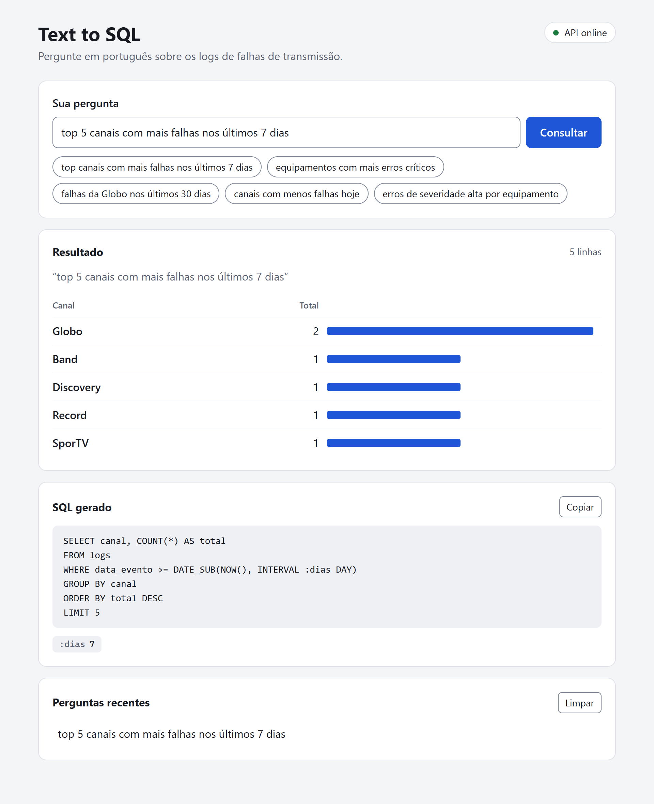

# Text to SQL MVP

Um MVP (Minimum Viable Product) que converte perguntas em português em consultas SQL
sobre logs de falhas de transmissão.

[](https://github.com/KawanVictor/SQL-Interface/actions/workflows/ci.yml)

Repositório: https://github.com/KawanVictor/SQL-Interface



## Estrutura do projeto

```
SQL-Interface/
├── backend/             - API FastAPI (parser, gerador e validador de SQL)
├── frontend/            - Interface React com Vite
├── database/            - Script de criação do banco e dados de exemplo
└── docker-compose.yml   - Banco, API e interface em um comando
```

## Rodar com Docker

```bash
docker compose up --build
```

A interface fica em `http://localhost:5173` e a API em `http://localhost:8000`.
O banco é criado com os dados de exemplo na primeira subida.

## Rodar sem Docker

Requer Python 3.12+, Node 20+ e MySQL 8 ou MariaDB.

### Banco de dados

```bash
mysql -u root -p < database/init.sql
```

Rode uma vez só: cada execução insere de novo as linhas de exemplo.

### Backend

```bash
cd backend
python -m venv venv
venv\Scripts\activate          # Linux/macOS: source venv/bin/activate
pip install -r requirements.txt
```

Copie `backend/.env.example` para `backend/.env` e preencha as credenciais do banco.
Depois suba a API:

```bash
uvicorn app.main:app --reload
```

### Frontend

```bash
cd frontend
npm install
npm run dev
```

A aplicação fica disponível em `http://localhost:5173`.

O frontend chama `/api`, e o Vite repassa essas chamadas ao backend em
`http://localhost:8000`. Para apontar para outro endereço, copie
`frontend/.env.example` para `frontend/.env` e ajuste `BACKEND_URL`.

## Verificar

### Saúde da API

```bash
curl http://localhost:8000/health
```

Esperado: `{"status":"ok","db":"mysql"}` (ou `"mariadb"`). Se o banco não responder,
a API devolve 503.

### Testar uma query

```bash
curl -X POST http://localhost:8000/query \
  -H "Content-Type: application/json" \
  -d '{"question": "top 5 canais com mais falhas nos últimos 7 dias"}'
```

## O que o parser entende

| Na pergunta | Efeito |
|---|---|
| `equipamento(s)` | agrupa por equipamento |
| `tipo(s)` (ex.: "tipos de erro") | agrupa por tipo de erro |
| `hoje` | só eventos de hoje |
| `N dias`, `sete dias`, `trinta dias` | eventos dos últimos N dias (1 a 365) |
| `crítico`, `alta`, `média`, `baixa` | filtra por severidade |
| `globo`, `sportv`, `discovery`, `record`, `band` | filtra por canal |
| `rewrapper-01` | filtra por equipamento |
| `menos` | ordem crescente (o padrão é decrescente) |
| `top N`, `N primeiros` | limita a N linhas (o padrão é 50) |

Sem nenhuma dessas palavras, a consulta agrupa por canal.

## Testes

```bash
cd backend
pip install -r requirements-dev.txt
pytest
```

Os testes não precisam de banco de dados. O GitHub Actions roda os testes do backend
e o build do frontend a cada push e pull request.

## Licença

[MIT](LICENSE)
